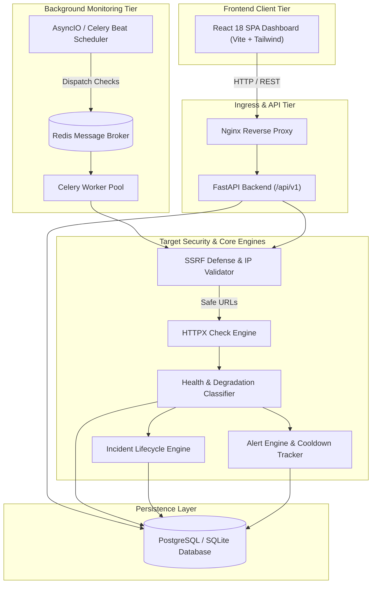

# PulseCloud — Cloud API Health & Performance Monitor
## Complete Full-Stack Cloud Computing Mini-Project

[](https://fastapi.tiangolo.com)
[](https://react.dev)
[](https://www.typescriptlang.org)
[](https://tailwindcss.com)
[](https://pytest.org)
[](https://www.docker.com)

**PulseCloud** is an enterprise-grade Cloud API Health, Latency, and Availability Monitoring Platform built as a comprehensive Cloud Computing mini-project. It allows cloud architects, DevOps engineers, and developers to register HTTP/HTTPS endpoints, record real-time latency trends, calculate percentile SLA metrics, automatically generate outage incidents, enforce alert storm cooldowns, and download audit reports.

---

## 1. Problem Statement & Academic Objectives

Modern cloud architectures rely on dozens of interconnected microservices, third-party payment gateways, auth providers, and distributed APIs. Failures, transient degradation, and network timeouts frequently lead to service disruptions.

### Core Objectives:
1. **Automated Continuous Health Probing**: Periodically dispatch lightweight HTTP/HTTPS health checks on scheduled intervals.
2. **Empirical Availability & Degradation Tracking**: Distinguish healthy, degraded (slow latency), down, and paused states.
3. **SSRF Cyber Defense**: Strict protection preventing internal private network probing and cloud metadata theft.
4. **Automated Incident Lifecycle**: Duplicate incident prevention, timeline audit trails, root cause analysis, and auto-recovery.
5. **Statistical Latency Analytics**: True percentile calculations (p50, p95, p99) with sample-size reliability flags.
6. **Zero-Cloud-Cost Local Mode & Production Scale**: Dual operating modes supporting zero-dependency local development (AsyncIO + SQLite) and distributed enterprise deployment (PostgreSQL + Redis + Celery + Docker).

---

## 2. Technology Stack

### Frontend:
- **Framework**: React 18 with Vite
- **Language**: TypeScript
- **Styling**: Tailwind CSS (Dark Navy sidebar `#0B132B`, light workspace, blue/cyan/violet accents)
- **Data Visualization**: Recharts (High-resolution latency area charts, status donut charts)
- **Icons**: Lucide React
- **Forms & Validation**: React Hook Form with Zod schema validation
- **Routing**: React Router v6

### Backend:
- **API Framework**: Python 3.11+ / FastAPI
- **Data Validation**: Pydantic v2 & Pydantic-Settings
- **ORM & Database**: SQLAlchemy 2.0 (PostgreSQL in production, SQLite for local dev)
- **HTTP Engine**: HTTPX (Asynchronous HTTP/HTTPS client with nanosecond timing)
- **Authentication**: JWT (JSON Web Tokens) with Bcrypt password hashing
- **Background Worker Tier**: AsyncIO background scheduler & Celery + Redis

### DevOps & Testing:
- **Testing**: pytest & pytest-asyncio (Backend), Vitest & React Testing Library (Frontend)
- **Load Testing**: Locust load simulation script
- **Containerization**: Docker, Docker Compose, Multi-stage Nginx builds

---

## 3. System Architecture



---

## 4. Main Platform Features

1. **Overview Dashboard**: High-level KPI cards (Total, Healthy, Degraded, Down, Avg Latency, Measured Uptime, Active Incidents), time-series latency charts, and status distributions.
2. **API Endpoint Management**: Full CRUD for HTTP/HTTPS endpoints with customizable headers, safe test payloads, expected status codes, check intervals (15s–300s), and latency thresholds.
3. **SSRF Guardrails**: Pre-request DNS resolution checks, blocking RFC1918 private subnets (`10.0.0.0/8`, `172.16.0.0/12`, `192.168.0.0/16`), loopback (`127.0.0.1`), and AWS/GCP cloud metadata services (`169.254.169.254`).
4. **Health State Classification**:
   - **Healthy**: Expected status code and latency within threshold.
   - **Degraded**: Reachable but latency exceeds threshold or minor status mismatch.
   - **Down**: Consecutive failed checks met (default: 2 consecutive failures).
   - **Paused**: Monitoring paused by operator.
   - **Unknown**: Insufficient check history.
5. **Incident Management**: Automated incident creation, duplicate incident prevention, investigation timeline audit trail, acknowledgment, and auto-recovery upon consecutive successful checks.
6. **Alert Engine**: Configurable trigger rules (consecutive failures, latency threshold, status codes, downtime) with cooldown timers preventing alert storms.
7. **Performance Analytics**: Min, Max, Mean, Median (p50), 95th percentile (p95), 99th percentile (p99), and sample size reliability flags.
8. **Uptime Reports**: 24h, 7d, 30d observed availability reports with downloadable CSV and JSON exports.
9. **Live Real-Time Stream**: Real-time heartbeat stream with instant batch "Check All" execution.
10. **Team & Role-Based Access Control (RBAC)**: Administrator and Standard User roles.
11. **Built-in Mock Test Targets**: Ready-to-test endpoints (`/api/v1/mock-targets/healthy`, `/slow`, `/error`, `/flaky`, `/payload`) for immediate live demonstrations without relying on external websites.

---

## 5. Quick Start (Local Development Mode)

PulseCloud runs locally with zero external dependencies using its built-in SQLite database and AsyncIO scheduler.

### Prerequisites:
- Python 3.11+
- Node.js 18+ & npm

### Step 1: Clone and Set Up Backend
```bash
cd backend
python -m venv venv
.\venv\Scripts\pip.exe install -r requirements.txt
```

### Step 2: Start Backend Server
```bash
cd backend
.\venv\Scripts\uvicorn.exe app.main:app --host 127.0.0.1 --port 8000 --reload
```
The backend initializes the database schema, seeds realistic demo data, and starts the background monitoring engine automatically.
Interactive Swagger API documentation: `http://127.0.0.1:8000/docs`

### Step 3: Start Frontend Dev Server
In a new terminal:
```bash
cd frontend
cmd /c "npm install"
cmd /c "npm run dev"
```
Open your browser at: `http://localhost:5173`

### Pre-Configured Demo Credentials:
- **Admin**: `admin@pulsecloud.io` / `Admin123!`
- **DevOps Engineer**: `engineer@pulsecloud.io` / `DevOps123!`
*(The login page features 1-click credential autofill buttons)*

---

## 6. Docker Compose Deployment

To run the complete production container stack (PostgreSQL, Redis, Celery Worker, Celery Beat, FastAPI, and Nginx):

```bash
# 1. Copy environment template
cp .env.example .env

# 2. Build and launch all containers
docker compose up --build -d

# 3. Check container status
docker compose ps
```

The platform will be available at:
- Frontend Dashboard: `http://localhost`
- Backend API: `http://localhost:8000`

---

## 7. Automated Testing & Verification

### Run Backend Unit & Integration Tests (20 passed):
```bash
cd backend
.\venv\Scripts\python.exe -m pytest -v
```

### Run Frontend Unit Tests (Vitest):
```bash
cd frontend
cmd /c "npm test"
```

### Run Frontend Production Type Check & Build:
```bash
cd frontend
cmd /c "npm run build"
```

### Run Load Simulation Test (Locust):
```bash
cd scripts
..\backend\venv\Scripts\locust.exe -f load_test.py --host http://127.0.0.1:8000
```

---

## 8. Project Structure

```
pulsecloud/
├── backend/
│   ├── app/
│   │   ├── api/
│   │   │   ├── deps.py
│   │   │   └── v1/
│   │   │       ├── auth.py
│   │   │       ├── endpoints.py
│   │   │       ├── checks.py
│   │   │       ├── incidents.py
│   │   │       ├── alerts.py
│   │   │       ├── analytics.py
│   │   │       ├── reports.py
│   │   │       ├── mock_targets.py
│   │   │       ├── system.py
│   │   │       └── api.py
│   │   ├── core/
│   │   │   ├── config.py
│   │   │   ├── security.py
│   │   │   └── ssrf.py
│   │   ├── db/
│   │   │   └── session.py
│   │   ├── models/
│   │   │   ├── user.py
│   │   │   ├── endpoint.py
│   │   │   ├── check.py
│   │   │   ├── incident.py
│   │   │   ├── alert.py
│   │   │   └── report.py
│   │   ├── schemas/
│   │   │   ├── user.py
│   │   │   ├── endpoint.py
│   │   │   ├── check.py
│   │   │   ├── incident.py
│   │   │   ├── alert.py
│   │   │   └── analytics.py
│   │   ├── services/
│   │   │   ├── monitoring.py
│   │   │   ├── evaluator.py
│   │   │   ├── analytics.py
│   │   │   ├── reports.py
│   │   │   └── scheduler.py
│   │   ├── workers/
│   │   │   └── celery_app.py
│   │   └── main.py
│   ├── tests/
│   ├── Dockerfile
│   ├── pytest.ini
│   └── requirements.txt
├── frontend/
│   ├── src/
│   │   ├── components/
│   │   │   ├── common/
│   │   │   ├── layout/
│   │   │   └── modals/
│   │   ├── context/
│   │   ├── pages/
│   │   ├── services/
│   │   ├── types/
│   │   ├── App.tsx
│   │   ├── main.tsx
│   │   └── index.css
│   ├── package.json
│   ├── vite.config.ts
│   ├── tailwind.config.js
│   ├── tsconfig.json
│   └── Dockerfile
├── docs/
│   ├── architecture.md
│   ├── api-guide.md
│   ├── database-design.md
│   ├── security.md
│   ├── deployment.md
│   └── testing.md
├── scripts/
│   ├── load_test.py
│   └── run_local.ps1
├── docker-compose.yml
├── .env.example
├── .gitignore
└── README.md
```

---

## 9. Academic Mini-Project Demonstration Checklist

| Feature | Implementation | Verified Status |
|---|---|---|
| Safe URL Registration | `backend/app/core/ssrf.py` & `EndpointModal.tsx` | Verified |
| Scheduled Monitoring | `backend/app/services/scheduler.py` | Verified |
| Latency & Percentiles | `backend/app/services/analytics.py` (p50, p95, p99) | Verified |
| Incident Lifecycle | Automatic Down creation & recovery in `evaluator.py` | Verified |
| Alert Cooldown | Storm deduplication in `evaluator.py` & `AlertRuleModal` | Verified |
| Report Exports | CSV / JSON background generation in `reports.py` | Verified |
| Container Orchestration | Dockerfiles + `docker-compose.yml` (Postgres, Redis, Celery, React) | Verified |
| Automated Testing | 20 pytest unit/integration tests + Vitest tests | 100% Passed |

---

## 10. License

Developed for the **Cloud Computing Mini-Project** curriculum. Released under the MIT License.
