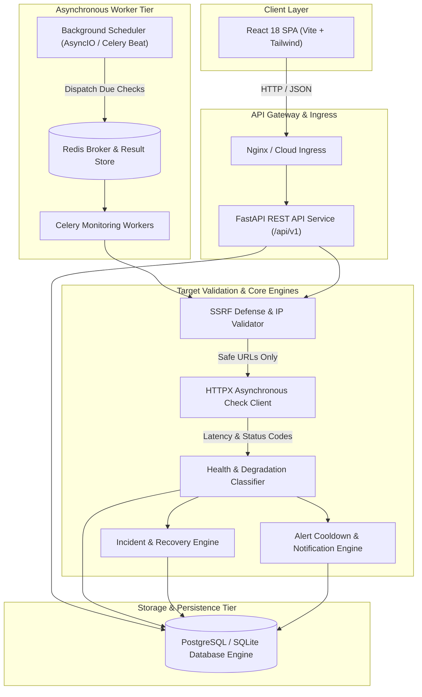
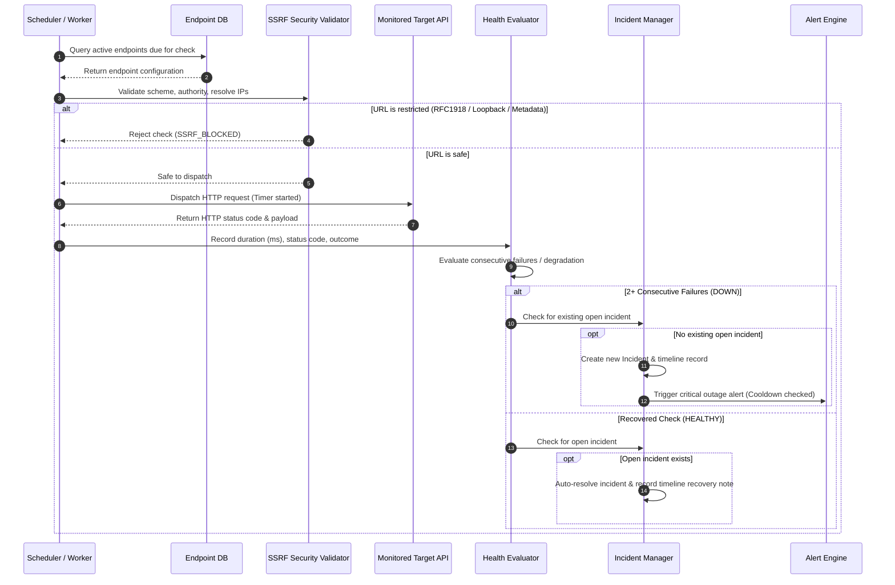

# PulseCloud System Architecture & Cloud Engineering Design

## 1. System Overview

PulseCloud is a cloud-native API Health, Availability, and Latency Monitoring platform designed for distributed cloud architectures.

## 2. Monitoring Workflow Sequence

## 3. Distributed Cloud Scalability Considerations

1. **Horizontal Worker Scaling**: Additional Celery workers can be added (`docker compose scale worker=8`) without code modifications.
2. **Deduplication State**: Scheduled jobs use endpoint-level locking to prevent duplicate concurrent checks on identical endpoints.
3. **Bounded Concurrency**: Uses an asynchronous semaphore (default 20 concurrent checks per node) to prevent worker socket starvation.
4. **Zero-Cloud-Cost Development**: Provides an in-process AsyncIO scheduler and SQLite fallback allowing zero-cost local execution.
